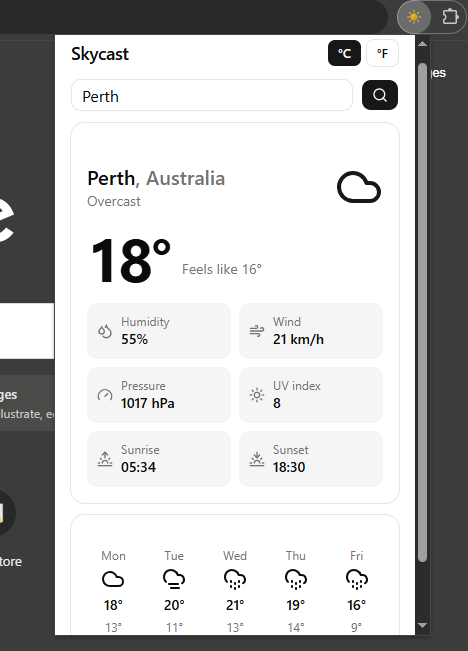

<div align="center">

# ☁️ Skycast

**A fast, minimal weather app: use it as a website or pin it to your browser as a Chrome extension.**

[](https://github.com/Tharanga8888/skycast-weather/actions/workflows/ci.yml)


[**Live demo**](https://skycast.vercel.app) · [**Download the extension**](https://github.com/Tharanga8888/skycast-weather/releases/latest) · [**Report a bug**](https://github.com/Tharanga8888/skycast-weather/issues)

<br />



</div>

---

## Overview

Skycast shows current conditions and a 5-day forecast for any city in the world. The same codebase ships two ways:

- 🌐 **A responsive website**, deployed on Vercel.
- 🧩 **A Chrome extension**: click the toolbar icon and the weather opens in a popup, no new tab needed.

It started life as a small vanilla HTML/CSS/JS project built on OpenWeatherMap. I rebuilt it from scratch with a modern, typed stack, dropped the API key entirely, and added a CI pipeline and an extension build.

## Features

- 🔎 **City search** with geocoding, so "Paris" and "Kandy" both just work
- 🌡️ **Current conditions**: temperature, feels-like, humidity, wind, pressure and UV index
- 🌅 **Sunrise and sunset** times in the city's local timezone
- 📅 **5-day forecast** with high/low temperatures and chance of rain
- 🔁 **°C / °F toggle**, saved between visits
- 💾 **Remembers your last city**
- ⏳ **Loading skeletons** and clear error messages (for example, unknown city or network failure)
- ♿ **Accessible by default**: labelled inputs, `role="alert"` on errors, icon labels
- 🔑 **No API key required**, so there is nothing to leak or rotate

## Tech stack

| Area | Choice |
| --- | --- |
| Framework | [Next.js](https://nextjs.org/) (App Router, static export) |
| Language | TypeScript |
| UI | React 19, [Tailwind CSS v4](https://tailwindcss.com/), [shadcn/ui](https://ui.shadcn.com/), [Lucide](https://lucide.dev/) icons |
| Data | [Open-Meteo](https://open-meteo.com/) forecast and geocoding APIs |
| Extension | Chrome Manifest V3 popup |
| Quality | ESLint, `tsc` type-checking |
| CI/CD | GitHub Actions, Vercel |

## How it works

```
 ┌────────────┐   geocode city    ┌──────────────────────────┐
 │  Search    │ ────────────────► │ geocoding-api.open-meteo │
 │  form      │                   └──────────────────────────┘
 └─────┬──────┘                              │ lat / lon
       │                                     ▼
       │                       ┌──────────────────────────┐
       └─────────────────────► │ api.open-meteo.com       │
                               │ current + daily forecast │
                               └────────────┬─────────────┘
                                            ▼
                         typed `Weather` model → React components
```

1. The city name is resolved to coordinates by the geocoding API.
2. Coordinates are sent to the forecast API (`timezone=auto`, so sunrise and sunset are already local).
3. The response is mapped into a typed `Weather` model in `src/lib/weather.ts`, and the UI renders from that model.
4. Weather codes are mapped to labels and icons in `src/lib/weather-codes.ts`.

Everything runs in the browser. There is no backend.

## Getting started

### Prerequisites

- Node.js **20.9 or newer** (CI uses Node 22)
- npm

### Run the website locally

```bash
git clone https://github.com/Tharanga8888/skycast-weather.git
cd skycast-weather
npm install
npm run dev
```

Open [http://localhost:3000](http://localhost:3000).

### Scripts

| Command | What it does |
| --- | --- |
| `npm run dev` | Start the dev server |
| `npm run build` | Production build of the website (static export to `out/`) |
| `npm run build:extension` | Build the site, then convert it into a Chrome-ready `extension/` folder |
| `npm run lint` | Run ESLint |
| `npm run typecheck` | Generate Next.js types, then run `tsc --noEmit` |

## Install as a Chrome extension

### Option A: download a release

1. Download `skycast-extension.zip` from the [latest release](https://github.com/Tharanga8888/skycast-weather/releases/latest) and unzip it.
2. Open `chrome://extensions` and turn on **Developer mode**.
3. Click **Load unpacked** and select the unzipped folder, the one that contains `manifest.json` directly.
4. Pin Skycast from the puzzle-piece menu, then click its icon.

### Option B: build it yourself

```bash
npm run build:extension
```

Then load the generated `extension/` folder as in steps 2 to 4 above. After any rebuild, press the reload ⟳ button on the extension's card.

> **Tip:** Chrome's "Loaded from" path on the extension card must end in `extension`, not `out` or the project root.

## Project structure

```
skycast-weather/
├── .github/workflows/ci.yml     # lint, typecheck, build, upload extension artifact
├── public/
│   ├── manifest.json            # Chrome Manifest V3
│   └── icons/                   # 16, 48 and 128 px toolbar icons
├── scripts/
│   └── build-extension.mjs      # makes the static export Chrome-compatible
├── src/
│   ├── app/                     # layout, page, global styles
│   ├── components/
│   │   ├── ui/                  # shadcn/ui primitives
│   │   ├── weather-app.tsx      # top-level client component and state
│   │   ├── search-form.tsx
│   │   ├── current-weather.tsx
│   │   └── forecast.tsx
│   ├── hooks/
│   │   └── use-local-storage.ts # useSyncExternalStore-based persistence
│   └── lib/
│       ├── weather.ts           # API client and typed models
│       ├── weather-codes.ts     # weather code → label + icon
│       └── units.ts             # °C / °F formatting
└── next.config.ts               # output: "export"
```

## Engineering notes

A few decisions worth explaining.

**Open-Meteo instead of OpenWeatherMap.** Any API key used in browser code is visible to everyone, and a static extension has no server to hide one behind. Open-Meteo needs no key, which removes the problem outright and keeps secrets out of the repository.

**One static export, two targets.** `next.config.ts` uses `output: "export"`, so the app is plain static files. Vercel serves them as a website, and a post-build script repackages them for Chrome.

**Making a Next.js export valid for Manifest V3.** Chrome extensions forbid inline scripts and reject top-level files or folders starting with `_`. `scripts/build-extension.mjs` handles this by:
- renaming `_next/` to `next/` and rewriting every reference,
- extracting inline `<script>` blocks into separate `.js` files,
- removing other underscore-prefixed top-level entries.

**Persisting state without effects.** Reading `localStorage` inside `useEffect` and then calling `setState` triggers cascading renders. `useLocalStorage` is built on `useSyncExternalStore` instead, with a server snapshot, so pre-rendering and hydration stay consistent and preferences sync across tabs.

**Type generation in CI.** Next.js generates some global types (such as `LayoutProps`) into `.next/`, which is gitignored. The `typecheck` script runs `next typegen` first, so it passes on a clean CI machine, not only on one that has already built the project.

## Continuous integration

Every push to `main` and every pull request runs [GitHub Actions](.github/workflows/ci.yml):

1. `npm ci`, a reproducible install from the lockfile
2. `npm run lint`
3. `npm run typecheck`
4. `npm run build:extension`
5. Upload the built extension as a downloadable artifact

Changes land through short-lived feature branches and pull requests, using [Conventional Commits](https://www.conventionalcommits.org/) (`feat:`, `fix:`, `ci:`, `docs:`).

## Roadmap

- [ ] "Use my location" button
- [ ] City autocomplete and recent searches
- [ ] Dark mode
- [ ] Hourly forecast
- [ ] Runtime validation of API responses with Zod
- [ ] Unit tests with Vitest, run in CI
- [ ] Publish to the Chrome Web Store

## Acknowledgements

- Weather data by [Open-Meteo.com](https://open-meteo.com/), licensed under [CC BY 4.0](https://creativecommons.org/licenses/by/4.0/)
- UI components from [shadcn/ui](https://ui.shadcn.com/), icons from [Lucide](https://lucide.dev/)

## License

Released under the [MIT License](LICENSE).

---

<div align="center">

Built by [YOUR NAME](https://github.com/Tharanga8888aw) · If you find this useful, a ⭐ is appreciated

</div>